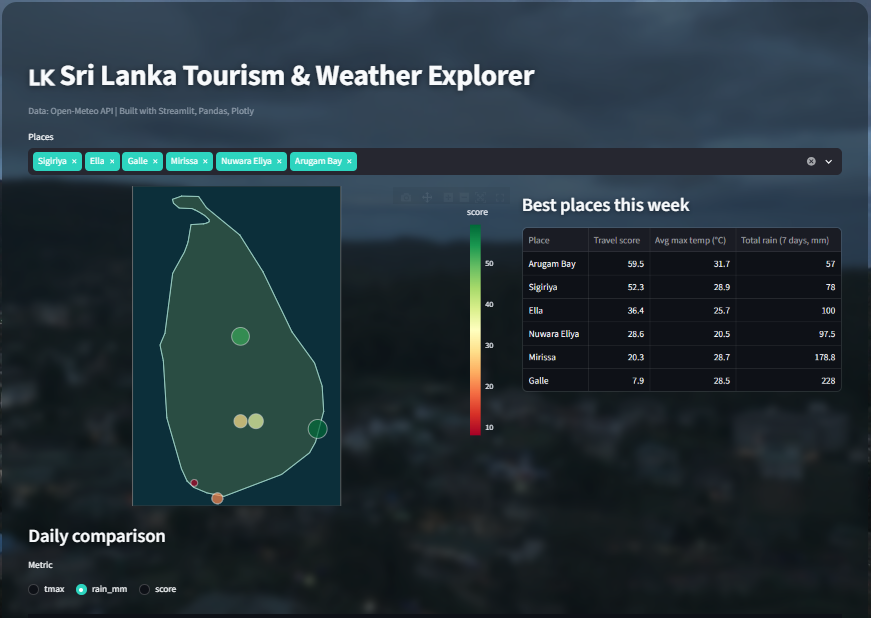

<div align="center">

# 🇱🇰 Sri Lanka Tourism & Weather Explorer

**Compare the weather across Sri Lanka's top destinations, find the best place to go this week, and discover the best month to visit.**

[](https://sl-weather-prediction.streamlit.app/)


<br>



<sub>The app may take a few seconds to wake up if it has been idle.</sub>

</div>

---

## ✨ Features

| | Feature | Description |
|---|---|---|
| 🌦️ | **7-day forecast** | Live weather for 10 popular destinations from the Open-Meteo API |
| 🏆 | **Travel score** | A 0-100 score per place, ranked so you can see the best spots this week |
| 🗺️ | **Interactive map** | Colour-coded markers across Sri Lanka, hover for temperature and rain |
| 📈 | **Daily comparison** | Compare max temperature, rain and score across places and days |
| 📅 | **Best month to visit** | Average monthly rain from 2023-2025 history, with the driest month highlighted |
| 🎨 | **Polished UI** | Dark glass design with an optional rain video background |

**Destinations:** Sigiriya · Ella · Galle · Mirissa · Nuwara Eliya · Kandy · Arugam Bay · Jaffna · Yala · Trincomalee

## 🧮 How the travel score works

```text
score = 100 - (rain_mm × 4) - (|max_temp - 29| × 3)      # clamped between 0 and 100
```

Less rain and a max temperature close to 29°C give a higher score. The weights are easy to tweak in `travel_score()` inside `app.py`.

## 🔄 Data pipeline

```text
Open-Meteo Forecast API ──► Pandas (clean + aggregate) ──► Travel score ──► Plotly charts + map
Open-Meteo Archive API  ──► build_history.py ──► data/monthly_climate.csv ──► Best month chart
```

- **Forecast** data is fetched live (cached for 1 hour, with retry on rate limits).
- **Historical climate** is pre-computed once with `build_history.py` and stored as a CSV, so the deployed app never depends on the archive API and loads fast.

## 🛠️ Tech stack

| Area | Tools |
|------|-------|
| App / UI | Python, Streamlit, custom CSS |
| Data | Pandas, Open-Meteo Forecast and Archive APIs (no API key needed) |
| Visualisation | Plotly (scatter geo map, line and bar charts) |
| Deployment | Streamlit Community Cloud, GitHub |

## 📁 Project structure

```text
sl-tourism-explorer/
├── app.py                  # Streamlit app (UI, charts, travel score)
├── places.py               # Destinations and coordinates
├── build_history.py        # One-off script to build the historical CSV
├── data/
│   └── monthly_climate.csv # Pre-computed monthly climate per place
├── static/
│   └── rain.mp4            # Optional background video
├── docs/
│   └── screenshot.png
├── .streamlit/
│   └── config.toml         # Theme and server settings
└── requirements.txt
```

## 🗺️ Roadmap

- [ ] More destinations and categories (beach, hills, wildlife)
- [ ] Let users customise the travel score weights
- [ ] Tests and GitHub Actions CI
- [ ] Next.js + TypeScript version deployed on Vercel

## 📚 What I learned

- Building a data pipeline: collect → clean → aggregate → visualise
- Working with REST APIs, caching, retries and rate limits (HTTP 429)
- Pre-computing static data to make a deployed app faster and more reliable
- Deploying a Python app from GitHub to Streamlit Community Cloud

## 🙏 Data source

Weather data by [Open-Meteo](https://open-meteo.com/).

---

<div align="center">

Built by [@Binusha0826](https://github.com/Binusha0826) · If you like this project, give it a ⭐

</div>
